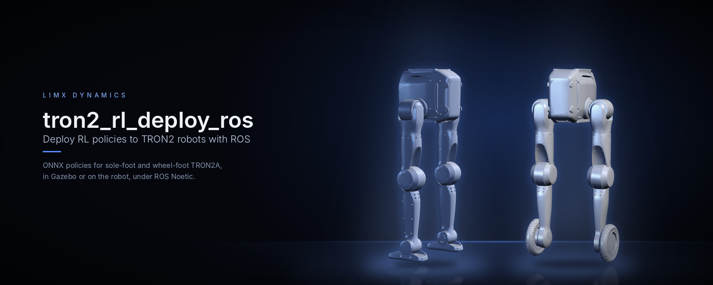
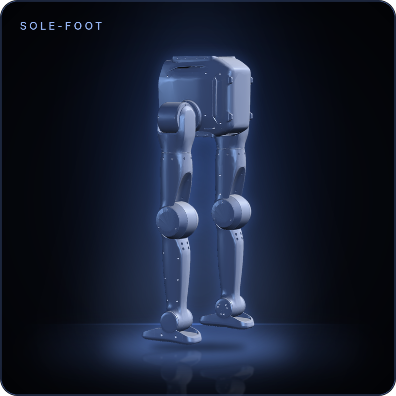
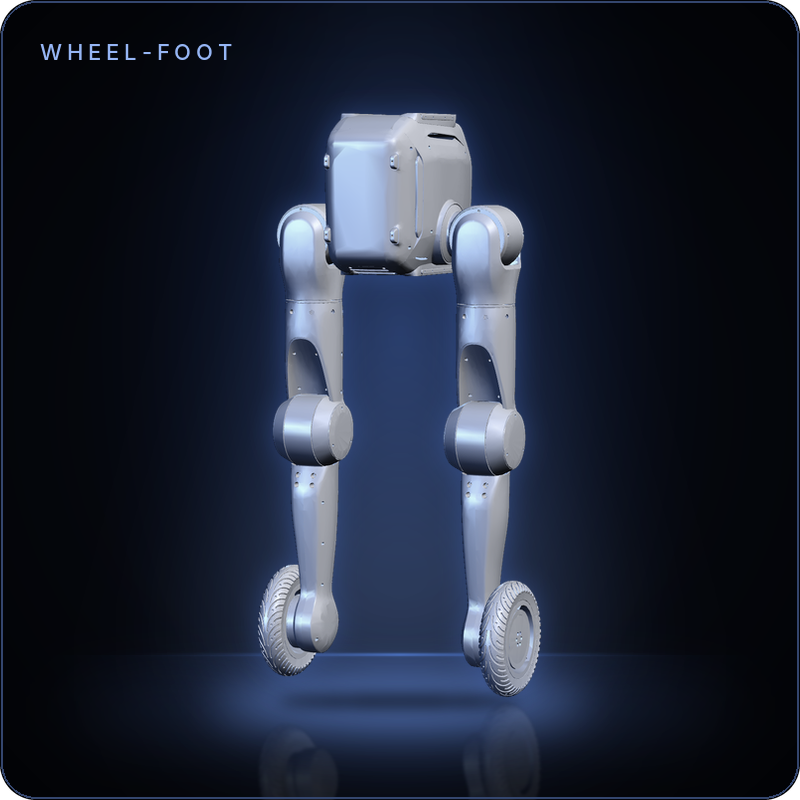
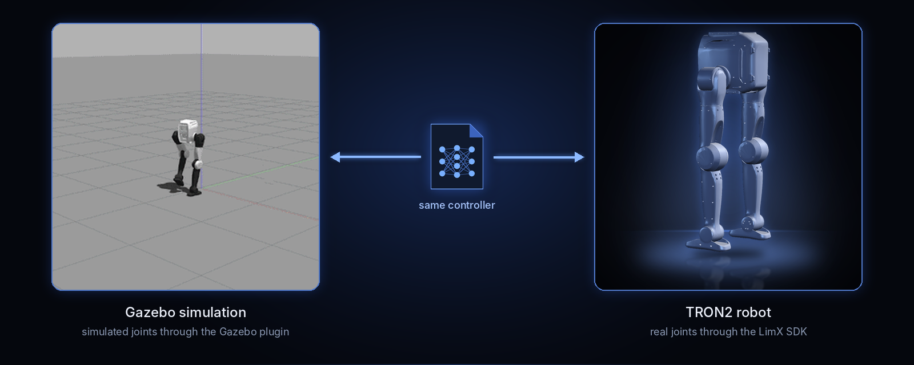
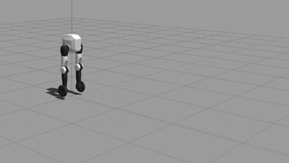

<!--
  SPDX-FileCopyrightText: 2024-2026 LimX Dynamics Technology Co., Ltd.
  SPDX-License-Identifier: Apache-2.0
-->

<p align="center">
  
</p>

<p align="center">
  <b>English</b> | <a href="README_zh-CN.md">中文</a>
</p>

<p align="center">
  <a href="LICENSE"></a>
  
  
  
</p>

# tron2_rl_deploy_ros

> **Distribution.** The primary distribution of this repository is
> [`github.com/limxdynamics/tron2_rl_deploy_ros`](https://github.com/limxdynamics/tron2_rl_deploy_ros).
> LimX's internal GitLab hosts a mirror; please open issues and pull
> requests on GitHub.

ROS Noetic deployment of reinforcement-learning locomotion policies on the
TRON2A biped, sole-foot (`SF_TRON2A`) and wheel-foot (`WF_TRON2A`).
`tron2_hw` wraps the LimX SDK as a `ros_control` hardware interface and
`tron2_controller` runs the ONNX policy and history encoder through ONNX
Runtime. The same launch files drive the robot or, with
[tron2_gazebo_ros](https://github.com/limxdynamics/tron2_gazebo_ros),
Gazebo Classic 11.

## Highlights

- **One control chain for simulation and the robot.**
  `tron2_hw_node` -> `RobotHWLoop` -> `controller_manager` ->
  `tron2_controller`; only the launch file changes.
- **Policies included.** Policy and encoder ONNX files for both variants
  ship in `tron2_controllers/config/<robot_type>/policy/`, with ONNX Runtime
  1.10 bundled in `onnxruntime_sdk`.
- **Standard ROS interfaces.** Drive with `/cmd_vel` and
  `/tron2_controller/set_mode`, or with the robot's remote through the SDK.
- **Safety hooks.** Start, stop and emergency-stop services on `tron2_hw`,
  per-joint position-step, velocity and torque limits in
  `tron2_hw/config/tron2_hw.yaml`.

## Supported robots

| | Model | Description | Joints / policy actions |
|:-:|---|---|:-:|
|  | `SF_TRON2A` | Biped with sole feet | 10 / 10 |
|  | `WF_TRON2A` | Biped with wheel feet | 10 / 10 |

## How it works

<p align="center">
  
</p>

## Quick start

Ubuntu 20.04 with ROS Noetic and the packages in [section 2](#2-requirements):

```bash
mkdir -p ~/limx_ws/src && cd ~/limx_ws/src
git clone https://github.com/limxdynamics/tron2_rl_deploy_ros.git
git clone https://github.com/limxdynamics/tron2_gazebo_ros.git
git clone https://github.com/limxdynamics/tron2-robot-description.git
git clone https://github.com/limxdynamics/limxsdk-lowlevel.git

cd ~/limx_ws
source /opt/ros/noetic/setup.bash
catkin_make
source devel/setup.bash
roslaunch tron2_hw tron2_hw_sim.launch robot_type:=SF_TRON2A use_joystick:=false
```

Then switch to walking from a second terminal (see [section 4.4](#44-gamepad-and-topics)).
On the robot, replace the last line with
`roslaunch tron2_hw tron2_hw.launch robot_type:=SF_TRON2A robot_ip:=<robot-ip>`
and read section 4.4 and section 5 first.

---

## 1. Directory layout

The recommended layout is:

```text
~/limx_ws/src
├── CMakeLists.txt                 # catkin top-level entry (usually a symlink)
├── tron2-robot-description        # Robot URDF / description package `robot_description` (top-level under src)
├── limxsdk-lowlevel               # Low-level SDK package (top-level under src)
├── tron2_gazebo_ros               # Simulation-related package group
│   ├── limxsdk-sim
│   └── tron2_gazebo
└── tron2_rl_deploy_ros            # Control / deployment package group (this repository)
    ├── onnxruntime_sdk
    ├── robot_common
    ├── tron2_controllers
    └── tron2_hw
```

> Note: catkin discovers packages recursively, so the sub-directory grouping does not affect the build as long as every ROS package contains a valid `package.xml` and `CMakeLists.txt`.

## 2. Requirements

- Ubuntu 20.04
- ROS Noetic (`ros-noetic-desktop-full` recommended)
- Gazebo 11 (default with ROS Noetic)
- Common dependencies (install as needed):

```bash
sudo apt-get update
sudo apt-get install -y \
  ros-noetic-gazebo-ros-pkgs \
  ros-noetic-gazebo-ros-control \
  ros-noetic-ros-control \
  ros-noetic-ros-controllers \
  ros-noetic-controller-manager \
  ros-noetic-joint-state-controller \
  ros-noetic-rqt-controller-manager \
  ros-noetic-robot-state-publisher \
  libeigen3-dev
```

## 3. Build

Clone the four repositories into the workspace:

```bash
mkdir -p ~/limx_ws/src && cd ~/limx_ws/src
git clone https://github.com/limxdynamics/tron2_rl_deploy_ros.git
git clone https://github.com/limxdynamics/tron2_gazebo_ros.git
git clone https://github.com/limxdynamics/tron2-robot-description.git
git clone https://github.com/limxdynamics/limxsdk-lowlevel.git
```

Then run from the workspace root:

```bash
cd ~/limx_ws
source /opt/ros/noetic/setup.bash
catkin_make
```

After a successful build, load the workspace environment:

```bash
source ~/limx_ws/devel/setup.bash
```

## 4. Running the examples

### 4.1 Launch the simulation (full deployment)

```bash
cd ~/limx_ws
source /opt/ros/noetic/setup.bash
source devel/setup.bash
# Launch the full stack: Gazebo world, hardware node, and controllers.
roslaunch tron2_hw tron2_hw_sim.launch robot_type:=SF_TRON2A
```

`robot_type` can be switched to match your configuration (e.g. `SF_TRON2A` / `WF_TRON2A`).

### 4.2 Launch only the controller (simulation mode)

If you have already brought up a Gazebo world manually, you can start just the hardware node and the controllers:

```bash
roslaunch tron2_hw tron2_controller_sim.launch robot_type:=SF_TRON2A
```

### 4.3 Real-hardware deployment

```bash
roslaunch tron2_hw tron2_hw.launch robot_type:=SF_TRON2A robot_ip:=<robot-ip>
```

**Note on `<robot-ip>`.** The `<robot-ip>` token in shipped command
examples is a placeholder — substitute your robot's actual IP
before running. `robot_ip` has no default: `tron2_hw.launch` requires
the argument, and `tron2_hw_node` exits with an error when the
parameter is missing. No robot address is hard-coded in the source.
See [`SECURITY.md`](SECURITY.md) and
[`THIRD_PARTY_NOTICES.md`](THIRD_PARTY_NOTICES.md) §7 for the
private-IP handling policy.

### 4.4 Gamepad and topics

On the robot, `tron2_hw` reads the remote through the SDK (`SensorJoy`). In
simulation the same mapping comes from a USB gamepad through
`tron2_gazebo`'s teleop node, or you can publish the topics yourself.

| Input | Effect |
|---|---|
| L1 + Y | Start `tron2_controller`, or switch it to `WALK` when it is running |
| L1 + X | Switch to `IDLE` |
| Left stick up / down | `/cmd_vel` linear x |
| Left stick left / right | `/cmd_vel` linear y |
| Right stick left / right | `/cmd_vel` angular z |

Stick values are scaled by `commands/max` in
`tron2_controllers/config/<robot_type>/params.yaml` (1.0 m/s, 1.0 m/s and
1.0 rad/s for `SF_TRON2A`). Without a gamepad:

```bash
rostopic pub -1 /tron2_controller/set_mode std_msgs/String "data: 'WALK'"
rostopic pub -r 10 /cmd_vel geometry_msgs/Twist "{linear: {x: 0.3}}"
```

`tron2_hw` also offers the services `/tron2_hw/start_controller`,
`/tron2_hw/stop_controller`, `/tron2_hw/emergency_stop` and
`/tron2_hw/reset_emergency_stop` (see `tron2_hw/docs/bringup_mvp.md`).

**Start-up behaviour.** `tron2_hw.launch` starts `tron2_controller`
without a button press: the `controller_spawner` node starts it, and
`tron2_hw_node` requests a start 1.2 s after its control loop is up. The
controller begins in `STAND` and moves every joint to the default pose.
Joint commands are sent from the first control cycle; they are held back
only while the robot reports a non-zero `calibration` diagnostic
(`require_calibration_state` in `tron2_hw.yaml` is currently not used).
L1 + Y is therefore only needed after the controller has been stopped.
Keep the robot suspended before you launch, and use
`/tron2_hw/emergency_stop` or `/tron2_hw/stop_controller` to stop it.

**`STAND` does not balance.** It only holds the joints at the default
pose. Switch to `WALK` (L1 + Y, or the topic above) as soon as the robot
touches down; in Gazebo, do it while `tron2_hw_sim.launch` still holds the
base in the air (`air_hold_duration`, 2 s by default). Left in `STAND`,
the robot tips over within about 2 s.

## 5. Simulation vs real-hardware logic (important safety notes)

Bottom line: **the core control chain is identical**, and in both cases it is:

- `tron2_hw_node` (`Tron2HW`) -> `RobotHWLoop` -> `controller_manager` -> `tron2_controller`

The two modes only differ on the input side:

- Simulation (`tron2_hw_sim.launch`) additionally publishes `/cmd_vel` and `/tron2_controller/set_mode` by default.
- Real hardware (`tron2_hw.launch`) receives its inputs mainly through the SDK-subscribed channels.

Real-hardware bring-up must always be an explicit, supervised operator action. Keep the robot suspended when starting the controller, and know where the emergency-stop is before enabling the `controller_manager`. See `tron2_hw/docs/bringup_mvp.md` and `SECURITY.md`.

## 6. Configuration file locations

The primary control parameters live in:

- `tron2_rl_deploy_ros/tron2_controllers/config/SF_TRON2A/params.yaml`
- `tron2_rl_deploy_ros/tron2_controllers/config/WF_TRON2A/params.yaml`

## 7. Screenshots / GIFs

### 7.1 Simulation deployment

| SF_TRON2A | WF_TRON2A |
| :---: | :---: |
|  |  |

### 7.2 Real-hardware deployment

Always suspend the robot before starting the controller during real-hardware deployment.


| SF_TRON2A | WF_TRON2A |
| :---: | :---: |
|  |  |

## 8. FAQ

- Launch fails with "package not found":
  - Make sure you have run `source /opt/ros/noetic/setup.bash`.
  - Make sure you have run `source ~/limx_ws/devel/setup.bash`.
- Build fails after moving directories:
  - Re-run `catkin_make` from `~/limx_ws`.
- Gazebo plugin / controller fails to load:
  - Confirm that `tron2_gazebo`, `tron2_hw`, and `tron2_controllers` all built successfully first.
- `tron2.h` fails with `mros/hand_msgs/HandCmd.h: No such file or directory`:
  - Update limxsdk-lowlevel (`git -C ~/limx_ws/src/limxsdk-lowlevel pull`);
    the include was replaced by forward declarations on 2026-10-27.
- `GripperCmd does not name a type` while building `tron2_hw`:
  - An older copy of the SDK headers shadows limxsdk-lowlevel. Update
    `tron2_gazebo_ros` (its `limxsdk-sim` no longer copies headers into
    `devel/include`), then `rm -rf build devel` and rebuild.


## Verification

The commands below mirror the CI workflow at
[`.github/workflows/ci.yml`](.github/workflows/ci.yml). Running them
locally before opening a PR saves review round-trips.

```bash
# 1. Build succeeds against the sibling workspace
cd ~/limx_ws
source /opt/ros/noetic/setup.bash
catkin_make

# 2. Every package.xml is well-formed
xmllint --noout $(find . -name 'package.xml')

# 3. Every unresolved <license> line still carries the ⚠ TO CONFIRM
#    annotation (CI fails if any silently loses the annotation).
find . -name 'package.xml' -exec grep -Hn '<license>' {} \;

# 4. No uncontrolled binaries / weights / bags. The output must exactly
#    match the pre-existing controlled set in THIRD_PARTY_NOTICES.md.
git ls-files | grep -iE '\.(onnx|pt|pth|ckpt|so(\.[0-9.]+)?|dll|dylib|lib|whl|bag|mcap)$'

# 5. Private-IP scan (only the documented example 10.192.1.2 is allowed;
#    Markdown/YAML examples should use the <robot-ip> substitution token).
grep -RIn --exclude-dir=.git -E \
  '\b(10\.[0-9]+\.[0-9]+\.[0-9]+|192\.168\.[0-9]+\.[0-9]+)\b' .
```


CI for this pass built the full workspace in a `ros:noetic` container
(here and in
[tron2_gazebo_ros](https://github.com/limxdynamics/tron2_gazebo_ros/actions)),
including `tron2_hw`, `tron2_controllers`, `robot_common` and
`onnxruntime_sdk`. In the Gazebo smoke test, with `WALK` sent during the
air hold, SF_TRON2A stood at 0.73 m and walked forward in every run;
WF_TRON2A stood in a run at real-time factor 1.0 but fell in one at 0.23
and still needs a desktop check. The real-robot path was not run.

---

## Cite & support

If you use this deployment stack in academic or public work, please
cite the repository:

```
@misc{limx_tron2_rl_deploy_ros_2026,
  title  = {TRON2 RL deployment for ROS},
  author = {LimX Dynamics},
  year   = {2026},
  howpublished = {\url{https://github.com/limxdynamics/tron2_rl_deploy_ros}}
}
```

- **Bug reports / feature requests:** [GitHub Issues](https://github.com/limxdynamics/tron2_rl_deploy_ros/issues).
- **Questions / integration help:** see the [FAQ](#8-faq) first, then open a [GitHub issue](https://github.com/limxdynamics/tron2_rl_deploy_ros/issues).
- **Security or robot-safety reports:** email `contact@limxdynamics.com`
  with subject prefix `[tron2-rl-deploy-ros]`; see [`SECURITY.md`](SECURITY.md).
- **Company / commercial contact:** <https://www.limxdynamics.com>.

---

## License & attribution

This project is licensed under the **Apache License, Version 2.0**
(January 2004) at the repository top level. See the [`LICENSE`](LICENSE)
file for the full text. SPDX identifier: `Apache-2.0`.

- [`NOTICE`](NOTICE) — required attribution notice, and the list of
  in-tree artifacts whose license status is **not** yet covered by
  the top-level Apache-2.0 grant.
- [`THIRD_PARTY_NOTICES.md`](THIRD_PARTY_NOTICES.md) — per-artifact
  provenance and every `⚠ TO CONFIRM` item.
- [`SECURITY.md`](SECURITY.md) — how to report a vulnerability, plus
  real-hardware safety notes.
- [`CONTRIBUTING.md`](CONTRIBUTING.md) — ROS C++ workflow, model /
  weight provenance checklist, binary artifact policy, DCO sign-off.
- [`CHANGELOG.md`](CHANGELOG.md) — release notes, including the
  "Pending owner sign-off" list that blocks the first public tag.

## Scope / not included

**Included** in this repository:

- Four ROS packages: `tron2_hw`, `tron2_controllers`, `robot_common`,
  `onnxruntime_sdk`.
- Launch files for Gazebo simulation and real-hardware bring-up.
- Configuration for the `SF_TRON2A` and `WF_TRON2A` variants.

**Included but pending owner clearance** (see `THIRD_PARTY_NOTICES.md`):

- `onnxruntime_sdk/lib/libonnxruntime.so` and `libonnxruntime.so.1.10.0`
  (bundled ONNX Runtime binary, ~14.3 MB — vendor clearance and
  SHA-256 recording pending).
- `tron2_controllers/config/SF_TRON2A/policy/{policy,encoder}.onnx`
  and `tron2_controllers/config/WF_TRON2A/policy/{policy,encoder}.onnx`
  (RL policy / encoder weights — model owner and robot-safety owner
  clearance pending).
- All four `package.xml` files (`tron2_hw`, `tron2_controllers`,
  `robot_common`, `onnxruntime_sdk`) declare `<license>Apache-2.0</license>`.

**Excluded — by design:**

- No firmware or bootloader artifacts.
- No factory-calibration values (per-serial or global offsets).
- No motion / bag data (`*.bag`, `*.mcap`, HDF5 trajectory captures).
- No customer-specific or site-specific configuration.
- Launching `tron2_hw.launch` is the operator action that brings the
  robot up: it starts `tron2_controller` automatically, which moves the
  joints to the default pose (see section 4.4). Keep the robot suspended
  before launching; see `SECURITY.md`.

Real-hardware bring-up details, including start / stop / emergency-stop
service names, are documented in `tron2_hw/docs/bringup_mvp.md` and
are pending robot-safety owner sign-off before public release.
